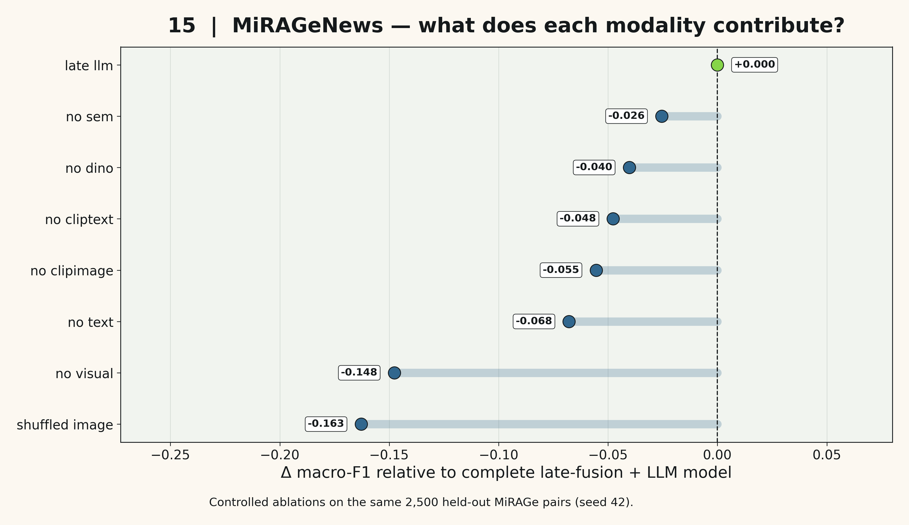
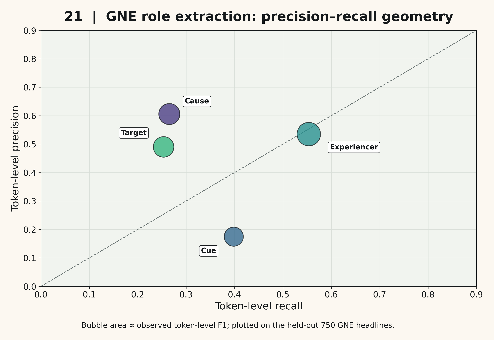
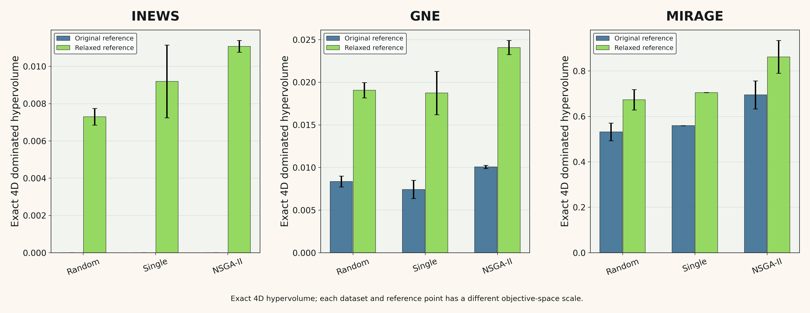
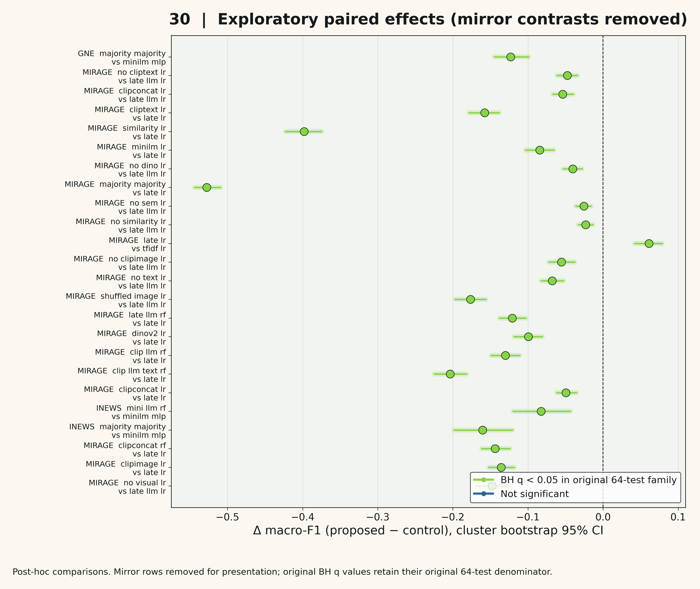
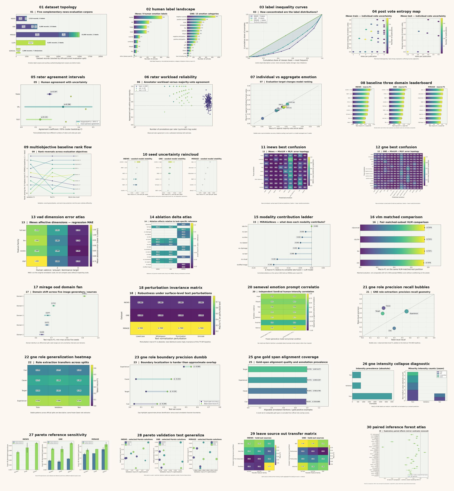

# NewsEmo
### Emotion, Evidence, and Multimodal Consistency in News

**A multi-level research framework for studying affective interpretation, structured semantic evidence, visual grounding, and multi-objective learning in news content.**

[](https://www.python.org/)


---

## Overview

News is more than a sequence of words. Emotional interpretation depends on framing, sources, events, individual perception, and, increasingly, the relationship between text and imagery.

**NewsEmo** investigates these interacting dimensions through a unified experimental framework spanning five complementary news datasets.

The central question is:

> **When do structured semantic descriptions and multimodal evidence improve news understanding—and when do they merely increase model complexity without improving generalization?**

Rather than treating language-model predictions as intrinsically superior, NewsEmo evaluates their contributions against conventional text representations, frozen foundation-model embeddings, image encoders, and lightweight supervised classifiers.

The framework connects three research directions:

1. **Affective interpretation:** Human emotion labels, annotator disagreement, continuous affective dimensions, and emotional roles.
2. **Multimodal consistency:** Visual grounding, caption–image compatibility, synthetic-news detection, and out-of-distribution generalization.
3. **Evidence-aware optimization:** Feature ablations, source transfer, multi-objective optimization, uncertainty estimation, and statistical testing.

The goal is not to collapse these distinct tasks into a single accuracy metric. Instead, NewsEmo studies where they reinforce one another, where they diverge, and which representations remain useful under controlled evaluation.

---

## At a Glance

| Component | Scope |
|:--|:--|
| News datasets | 5 |
| Prepared records | 31,435 |
| Main tracked experimental runs | 540 |
| Multi-objective optimization runs | 27 |
| Robustness evaluations | 85 |
| Original bootstrap confidence intervals | 38 |
| Additional non-overlapping confidence intervals | 98 |
| Exploratory paired comparisons | 64 |
| Human annotator agreement | Krippendorff's α, pairwise agreement, bootstrap CI |
| Structured emotional roles | Cue, cause, target, experiencer |
| Scientific figures | 28 rendered, PDF + PNG |
| Main random seeds | 42, 43, 44, 45, 46 |

The dataset counts represent different tasks and annotation protocols; they should not be interpreted as one pooled training set.

---

## Research Architecture

```text
                        NEWS SOURCES
                             |
            +----------------+----------------+
            |                |                |
         TEXT             IMAGES         ANNOTATIONS
            |                |                |
    +-------+-------+    +---+----+     +-----+------+
    |       |       |    |        |     |            |
  TF-IDF  MiniLM   LLM  CLIP    DINOv2  Emotion     Roles
    |       |       |    |        |     Labels       |
    |       |       |    +---+----+     / VAD      Spans
    |       |       |        |             |          |
    +-------+-------+--------+-------------+----------+
                             |
                   FEATURE REPRESENTATIONS
                             |
             +---------------+---------------+
             |               |               |
         Classical        Multimodal       Structured
         Baselines          Fusion          Semantics
             |               |               |
             +---------------+---------------+
                             |
                        EVALUATION
                             |
       +----------+----------+----------+----------+
       |          |          |          |          |
     Human     Ablation    Source      OOD      Bootstrap
   Agreement    Studies    Transfer   Stress      / BH
       |          |          |          |          |
       +----------+----------+----------+----------+
                             |
                     MULTI-OBJECTIVE
                       OPTIMIZATION
                             |
                 NSGA-II / Random / Single
                             |
                  REPRODUCIBLE RESULTS
                   TABLES + FIGURES
```

### Core Design Principles

- **Task separation:** Emotion classification, image–text consistency, and authenticity detection are evaluated as different prediction problems.
- **Label-independent semantic extraction:** Language models describe observable textual or visual evidence without receiving the downstream target labels.
- **Comparable baselines:** Additional complexity is assessed against simpler alternatives.
- **Matched evaluation:** Image-language models are compared against other encoders on matching subsets.
- **Document-aware uncertainty:** Cluster-level resampling respects document grouping.
- **Transparent negative results:** Weak performance and failed improvements are retained and reported rather than hidden.
- **Artifact preservation:** Experiments, predictions, tables, figures, and logs are organized as separate stages.

---

## Datasets

NewsEmo uses five datasets with complementary annotation structures.

| Dataset | Records | Primary Task | Evaluation Focus |
|:--|--:|:--|:--|
| **iNews** | 2,510 | Emotion classification and VAD | Human disagreement, individual versus aggregated labels |
| **GoodNewsEveryone** | 5,000 | Emotion and emotional roles | Classification, cue/cause/target/experiencer extraction |
| **MiRAGeNews** | 15,000 | Multimodal authenticity | Text–image fusion, ablations, OOD evaluation |
| **NewsCLIPpings** | 6,925 | Out-of-context image–text detection | Zero-shot compatibility and retrieval-style scoring |
| **SemEval-2007 Affective Text** | 1,000 | Continuous emotion estimation | External zero-shot correlation and MAE |

### Dataset Protocols

**iNews**

- 2,028 training posts, 128 validation posts, 354 test posts.
- Nine aggregated categorical labels.
- Original annotator votes retained for additional human-agreement analysis.
- Official cold-start test partition preserved.

**GoodNewsEveryone**

- 3,500 training, 750 validation, and 750 test headlines.
- Fifteen emotion categories.
- Structured emotional annotations including cues, causes, targets, and experiencers.
- Group-aware splitting and independent role-extraction evaluation.

**MiRAGeNews**

- 10,000 training and 2,500 validation examples.
- Five additional test domains, each containing 500 examples.
- Binary authenticity classification.
- Paired image–text evaluation and controlled modality removal.

**NewsCLIPpings**

- 6,925 valid test pairs.
- Zero-shot out-of-context detection.
- An additional 1,000-pair matched subset for VLM comparisons.

**SemEval-2007**

- 1,000 externally evaluated news headlines.
- Six emotion dimensions and valence.
- Human-annotation-based continuous targets.

Raw datasets and pretrained foundation-model weights are not redistributed by this repository. Users must obtain them from their original providers and comply with the corresponding terms.

---

## Representation Families

NewsEmo studies representations at different levels of abstraction.

| Family | Methods | Role |
|:--|:--|:--|
| Sparse text | TF-IDF | Lexical reference baseline |
| Dense text | MiniLM | Contextual sentence representations |
| Text statistics | Length, punctuation, lexical diversity, attribution | Lightweight interpretable cues |
| LLM semantics | Qwen2.5-7B-Instruct | Structured descriptions of framing, uncertainty, urgency, attribution, and related properties |
| Visual semantics | Qwen2.5-VL | Scene-level visual descriptions and caption–image alignment |
| Contrastive vision-language | CLIP ViT-B/32, ViT-L/14 | Image–text compatibility |
| Visual representation | DINOv2 | Non-linguistic image features |
| Fusion | Concatenation and late fusion | Combined evidence |
| Supervised predictors | Logistic regression, SVM, random forests, MLP | Downstream evaluation |

Structured features are treated as hypotheses about useful information, **not as ground-truth explanations**.

---

## Experimental Results

### 1. Emotion Classification

Best observed baseline results, averaged over the main seed protocol:

| Dataset | Representation | Classifier | Test Macro-F1 |
|:--|:--|:--|--:|
| iNews | MiniLM | MLP | **0.2078** |
| GoodNewsEveryone | MiniLM | MLP | **0.1641** |

Performance on fine-grained human emotion labels remains limited, motivating explicit analysis of annotator disagreement and label ambiguity.

### 2. Multimodal News Authenticity

| Dataset | Configuration | Metric | Score |
|:--|:--|:--|--:|
| MiRAGeNews | Late fusion + LR | Macro-F1 | 0.8610 |
| MiRAGeNews | Late fusion with semantic features, ablation suite | Macro-F1 | **0.8653** |
| NewsCLIPpings | CLIP ViT-L/14 | ROC-AUC | **0.8879** |
| NewsCLIPpings, matched 1K | CLIP ViT-L/14 | ROC-AUC | **0.8890** |
| NewsCLIPpings, matched 1K | Qwen2.5-VL alignment score | ROC-AUC | 0.7456 |

Different datasets and evaluation subsets are not directly comparable.

The strongest results emerge from combining complementary representations rather than relying exclusively on generated language-model descriptions.

### 3. Controlled Modality Ablations



Removing visual information, perturbing image associations, or removing semantic feature groups changes downstream performance.

On the held-out MiRAGeNews evaluation, selected paired comparisons against the complete late-fusion semantic configuration show:

| Intervention | Δ Macro-F1 |
|:--|--:|
| Remove semantic feature group | −0.0255 |
| Remove visual modality | −0.1477 |
| Shuffle images | −0.1765 |

These comparisons support the importance of multimodal evidence, while also illustrating that individual representation groups contribute unequally.

### 4. Human Annotation Reliability

NewsEmo does not assume that aggregated emotion labels represent an unambiguous ground truth.

In iNews, annotator-level analysis finds:

| Metric | Training | Test |
|:--|--:|--:|
| Krippendorff's nominal α | 0.1968 | 0.1311 |
| Pairwise exact agreement | 0.3448 | 0.3099 |

The low agreement demonstrates substantial disagreement in human interpretation. It does not, by itself, establish a human performance ceiling for machine learning.

The framework therefore reports both post-level aggregate classification and evaluation against individual human annotations.

### 5. Emotional Role Extraction

NewsEmo extends GoodNewsEveryone analysis beyond sentence-level classification to structured spans.



Test-set results:

| Emotional Role | Token Precision | Token Recall | Token Micro-F1 |
|:--|--:|--:|--:|
| Experiencer | 0.5352 | 0.5534 | **0.5442** |
| Cause | 0.6058 | 0.2650 | 0.3687 |
| Target | 0.4906 | 0.2533 | 0.3341 |
| Cue | 0.1749 | 0.3983 | 0.2431 |

The analysis also distinguishes token overlap from exact span matching, exposing boundary-localization errors that document-level metrics would conceal.

---

## Multi-Objective Optimization

NewsEmo compares:

- **NSGA-II:** Population-based multi-objective search.
- **Random search:** Non-adaptive search baseline.
- **Single-objective optimization:** Reference strategy focused on predictive performance.

The optimization considers multiple competing properties, including validation performance, class-wise reliability, and representation complexity.

A dedicated extension replaces approximate hypervolume estimates with exact four-dimensional hypervolume calculations.



### Exact Hypervolume — Relaxed Reference

| Dataset | NSGA-II | Random | Single-objective |
|:--|--:|--:|--:|
| iNews | **0.0111** | 0.0073 | 0.0092 |
| GoodNewsEveryone | **0.0241** | 0.0191 | 0.0187 |
| MiRAGeNews | **0.8617** | 0.6729 | 0.7047 |

Values are averaged over three optimization seeds.

Hypervolume values are meaningful within the same objective space and reference-point convention; absolute values should not be compared across different datasets.

**Important diagnostic:** With the original reference point, all iNews fronts had zero hypervolume because worst-class recall was zero. The relaxed-reference analysis is reported separately rather than presented as an equivalent replacement.

These experiments indicate broader observed Pareto coverage for NSGA-II, without claiming that it consistently achieves the highest test macro-F1.

---

## Statistical Evaluation

The framework provides multiple complementary levels of statistical analysis:

- Repeated-seed performance summaries.
- Group-aware bootstrap confidence intervals.
- Additional non-overlapping bootstrap coverage for previously unevaluated predictions.
- Paired randomization tests.
- Benjamini–Hochberg multiple-testing correction.
- Source-holdout evaluation.
- Counterfactual image-pairing controls.
- Exact multi-objective hypervolume analysis.



The scientific extension evaluates 64 directional, exploratory paired comparisons. Mirror comparisons are removed from the displayed forest plot but remain identifiable in the original statistical output.

**Interpretation note:** These comparisons were conducted after inspecting the experimental results and must be considered exploratory/post hoc rather than preregistered confirmatory hypotheses.

---

## Robustness and Distribution Shift

NewsEmo evaluates whether observed gains survive outside the nominal evaluation setting.

The robustness suite includes:

- Five MiRAGeNews out-of-distribution test domains.
- Lowercasing and punctuation changes.
- Whitespace and Unicode perturbations.
- Source-holdout transfer.
- Shuffled and mismatched visual inputs.
- Matched image–text comparisons for VLM evaluation.

The purpose is to distinguish genuine cross-modal evidence usage from spurious associations, lexical shortcuts, and sensitivity to superficial text changes.

---

## Scientific Figure Atlas

The repository includes a reproducible collection of publication-oriented figures under [`FIGURES/`](FIGURES/).

The visual design follows the scientific figure conventions established in [fractional-lora-unlearning](https://github.com/cataug/fractional-lora-unlearning):

- Warm cream backgrounds and restrained panel surfaces.
- Viridis-inspired continuous palettes.
- Transparent uncertainty regions.
- High-contrast axes and labels.
- Large, readable scientific typography.
- Consistent visual grammar across experiments.

### Complete Gallery

[](FIGURES/00_gallery_contact_sheet.jpg)

The atlas spans six levels of analysis:

| Group | Topics |
|:--|:--|
| Dataset structure | Corpus composition, class imbalance, label concentration |
| Human annotation | Agreement, vote entropy, reliability, individual-versus-aggregate evaluation |
| Predictive performance | Baseline rankings, seed uncertainty, confusion matrices, VAD |
| Multimodal learning | Ablations, representation contributions, VLM comparisons, OOD |
| Structured evidence | Emotional roles, precision–recall geometry, span alignment, intensity imbalance |
| Optimization and inference | Hypervolume, source transfer, generalization, statistical effect sizes |

Selected figures:

| Multimodal evidence | Emotional role extraction |
|:--:|:--:|
|  |  |
| **Multi-objective optimization** | **Statistical inference** |
|  |  |

The atlas currently contains **28 successfully rendered figures** out of 30 planned. Figures 19 and 24 require data-type handling fixes; their error details are recorded in [`figure_manifest.json`](FIGURES/figure_manifest.json). The generated figure index links each successfully rendered plot to its data sources.

All completed figures are available as PDF and PNG.

---

## Repository Structure

```text
NewsEmo/
|
|-- FIGURES/
|   |-- build_figures.py
|   |-- figure_index.csv
|   |-- figure_manifest.json
|   |-- 00_gallery_contact_sheet.jpg
|   `-- *.pdf / *.png
|
|-- scripts/
|   |-- phase2.py
|   |-- phase2_autorun.py
|   |-- phase2_resume_strict.py
|   |-- phase2_scientific_extension.py
|   `-- additional experimental utilities
|
|-- cache/
|   `-- manifests/
|       |-- inews.csv
|       |-- gne.csv
|       |-- mirage.csv
|       |-- clips.csv
|       `-- semeval.csv
|
|-- results/
|   |-- baseline.csv
|   |-- ablation.csv
|   |-- vad.csv
|   |-- intensity.csv
|   |-- source_holdout.csv
|   |-- vlm.csv
|   |-- pareto.csv
|   |-- robustness.csv
|   |-- external.csv
|   |-- semeval_zeroshot.csv
|   |-- bootstrap_ci.csv
|   |-- paired_bootstrap_comparisons.csv
|   |
|   |-- pareto_fronts/
|   |-- figures/
|   `-- phase2_extension/
|
|-- reports/
|   `-- experiment summaries and diagnostics
|
|-- logs/
|   `-- execution logs
|
|-- setup_newsemo.sh
|-- NewsEmo_Phase2_one_command.sh
|-- NewsEmo_scientific_extension_one_command.sh
`-- NewsEmo_FIGURES_one_command.sh
```

Large datasets, image archives, pretrained model weights, and full inference caches are deliberately kept outside the lightweight GitHub distribution.

---

## Getting Started

### Clone the Repository

```bash
git clone git@github.com:cataug/NewsEmo.git
cd NewsEmo
```

Or use HTTPS:

```bash
git clone https://github.com/cataug/NewsEmo.git
cd NewsEmo
```

### Requirements

The original experiments were executed in a Linux environment with an NVIDIA A100 40 GB GPU.

The framework uses Python and common scientific computing libraries, including:

- NumPy, pandas, SciPy, scikit-learn.
- Matplotlib.
- PyTorch and Hugging Face Transformers.
- Pillow and PyArrow.
- Local checkpoints for Qwen, CLIP, MiniLM, and DINOv2.

Different model families may require different compatible Transformers environments.

**Portability notice:** Some experiment scripts contain absolute paths specific to the original research machine. Before reproducing the full pipeline elsewhere, adapt the project-root, dataset, model, and Python executable paths. This repository is a research artifact, not a fully containerized zero-configuration package.

### Explore the Experimental Engine

```bash
python scripts/phase2.py --help
```

The experimental engine exposes stages for data preparation, feature extraction, supervised evaluation, optimization, external assessment, and reporting.

For example:

```bash
# Prepare dataset manifests from locally available raw datasets
python scripts/phase2.py prepare

# Extract lightweight textual statistics
python scripts/phase2.py extract --dataset inews --encoder stats

# Train baseline configurations
python scripts/phase2.py baseline

# Calculate multi-objective optimization results
python scripts/phase2.py pareto

# Generate summary reports from completed results
python scripts/phase2.py report
```

These are individual stages, not a substitute for the complete dependency-ordered experimental protocol. Training stages require the relevant raw datasets and locally available feature caches.

### Rebuild the Figure Atlas

After restoring the required intermediate artifacts:

```bash
python FIGURES/build_figures.py --root "$PWD"
```

The script writes figures and a provenance manifest into `FIGURES/`.

**Note:** The currently published figure generator records two known plotting failures (19 and 24). Figures requiring saved prediction arrays also need those intermediate files restored locally. A fresh Git clone containing only the lightweight artifacts may therefore not reproduce every plot without additional inputs.

---

## Reproducibility and Experiment Tracking

### Seeds

```text
Supervised experiments:
42, 43, 44, 45, 46

Pareto optimization:
42, 43, 44
```

### Experiment Outputs

| Output | Description |
|:--|:--|
| [`baseline.csv`](results/baseline.csv) | Classical and representation-based baselines |
| [`ablation.csv`](results/ablation.csv) | Feature and modality removal studies |
| [`vlm.csv`](results/vlm.csv) | Matched multimodal VLM evaluations |
| [`pareto.csv`](results/pareto.csv) | Multi-objective optimization summaries |
| [`robustness.csv`](results/robustness.csv) | Perturbation and OOD results |
| [`external.csv`](results/external.csv) | NewsCLIPpings external evaluations |
| [`semeval_zeroshot.csv`](results/semeval_zeroshot.csv) | External emotion scoring |
| [`bootstrap_ci.csv`](results/bootstrap_ci.csv) | Original confidence intervals |
| [`paired_bootstrap_comparisons.csv`](results/paired_bootstrap_comparisons.csv) | Original paired statistical tests |

### Scientific Extension

The additional analyses are collected under [`results/phase2_extension/`](results/phase2_extension/):

| File | Scientific Purpose |
|:--|:--|
| `inews_rater_agreement.csv` | Human agreement and uncertainty |
| `inews_human_level_model_scores.csv` | Evaluation against individual human votes |
| `gne_role_metrics.csv` | Structured emotional-role extraction |
| `gne_gold_annotation_alignment_audit.csv` | Gold-span alignment audit |
| `gne_intensity_degeneracy.csv` | Intensity-label collapse diagnostics |
| `pareto_hypervolume_exact.csv` | Exact 4D hypervolume |
| `new_nonoverlapping_bootstrap_ci.csv` | Additional confidence intervals |
| `paired_randomization_BH_exploratory.csv` | Exploratory paired effects with multiplicity correction |

The extension preserves previously generated experiment files and writes new outputs separately.

---

## What the Results Suggest

Three observations emerge from the experimental program.

**1. Emotional understanding is constrained by annotation ambiguity.**

Fine-grained news-emotion classification is difficult not only because of limited model capacity, but also because humans frequently disagree on the dominant emotional interpretation.

**2. Structured semantics are useful conditionally, not universally.**

LLM-derived features can improve certain multimodal configurations, but they do not consistently outperform compact sentence representations on emotion-classification tasks.

**3. Multimodal evidence is most valuable when the task genuinely requires it.**

On image–text authenticity and compatibility tasks, strong fusion models outperform many single-modality alternatives. Controlled ablations and image-swapping experiments provide additional evidence that the visual modality contributes to the prediction.

These findings support a **task-dependent view of language-model and multimodal feature utility**, rather than a universal claim of superiority.

---

## Known Limitations

This repository retains limitations identified during the experiments:

1. **Low inter-annotator agreement.** Aggregated emotion labels may obscure legitimate differences in human interpretation.
2. **Class imbalance.** Several emotional categories are rare, limiting macro-F1 and rare-class recall.
3. **Degenerate intensity labels.** GoodNewsEveryone intensity is overwhelmingly annotated as `medium`; a constant predictor is more competitive than the learned regressors. Intensity results are treated as diagnostic rather than substantive evidence of successful affect prediction.
4. **Span boundary errors.** Emotional-role extraction can identify relevant regions without accurately recovering full annotated spans.
5. **Dataset-specific optimization behavior.** Better Pareto coverage does not necessarily imply better held-out classification.
6. **Limited optimization replicates.** Three seeds support descriptive comparisons but do not establish universal superiority.
7. **Post-hoc statistical comparisons.** Exploratory tests should not be interpreted as preregistered hypotheses.
8. **Task separation.** Synthetic-news authenticity and image–text consistency must not be confused with human emotion recognition.
9. **Artifact portability.** The full original computational environment, raw datasets, pretrained checkpoints, and large intermediate caches are not included in the lightweight repository.

These limitations are part of the reported research evidence rather than omitted implementation details.

---

## Research Use

NewsEmo is intended for work on:

- Affective computing and emotion recognition.
- News and social-media analytics.
- Explainable NLP and structured evidence extraction.
- Vision-language representation learning.
- Multimodal consistency and misinformation research.
- Robustness and out-of-distribution evaluation.
- Human annotation reliability.
- Multi-objective optimization and feature selection.
- Statistical evaluation of machine-learning systems.

The code is released as a research artifact. Dataset and pretrained-model licenses remain governed by their respective providers. Consult the repository for the current software licensing status.


---

